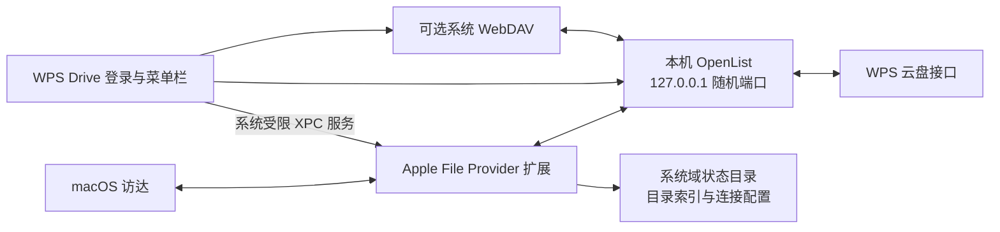

# WPS Drive for macOS


WPS 网盘的本机挂载助手。Swift / AppKit 应用使用本机 OpenList 的 WPS 驱动连接个人或企业空间，通过 Apple File Provider 在访达中提供占位文件、按需下载、本地保留和空间释放。也保留系统 WebDAV 网络磁盘模式。

0.3.0 默认使用原生云盘。关闭窗口后隐藏 Dock 图标，仅留菜单栏，连接继续运行。原生路径已在本机用 ad-hoc 签名跑通，不依赖 App Group 或付费开发者证书。

无需安装 WPS 桌面客户端，仍需可用的 WPS 账号与云空间权限。
网盘接入由 [OpenList](https://github.com/OpenListTeam/OpenList) 提供，感谢 OpenList 项目及贡献者。

这是独立非官方工具，当前为实验性预发布，不是 WPS 官方客户端。
真实 WPS 写入和其他 Mac 的首次安装尚未验收。

## 安装

[下载 v0.3.0 Apple Silicon 版 DMG](https://github.com/zgdllt/wps-drive-macos/releases/download/v0.3.0/WPS-Drive-v0.3.0-macos-arm64.dmg)，
或到 [Release 页面](https://github.com/zgdllt/wps-drive-macos/releases/tag/v0.3.0) 获取 ZIP 和校验文件。打开 DMG，
将应用拖到“应用程序”，再启动并登录 WPS。首次默认选择“原生云盘”，
按系统提示启用 WPS Drive 文件提供程序，然后点刷新。

应用未使用 Developer ID 签名或公证。首次打开、更新和系统启用步骤见
[安装说明](docs/INSTALL.md)。发布产物和当前发布状态见
[发布记录](docs/RELEASE.md)。

## 当前状态

| 阶段 | 状态 |
| --- | --- |
| 调研 SeaDrive、现有 WebDAV / File Provider 工具 | 已完成，见 [调研记录](docs/RESEARCH.md) |
| File Provider 原生目录和占位文件 | 通过；初始文件 `SF_DATALESS`，占用 0 数据块 |
| 后端鉴权、目录、中文文件上传下载、重命名、移动、删除 | 本机 Local 夹具测试通过 |
| 系统 WebDAV 访达挂载 | 通过；卷名 WPS，挂载后的读写、重命名、删除、弹出均通过独立夹具测试 |
| File Provider 按需读取 / 保留 / 释放 / 再下载 | 独立夹具通过；含文件夹清除子文件保留标记和重新继承 |
| File Provider 创建 / 重命名 / 删除 | 独立 Local 夹具通过；访达交互阶段的缓存释放通过 |
| 真实 WPS 账号接入 | 企业账号、原生目录、PDF 文件头读取、重启恢复原生连接通过；未对真实云端文件执行写入或删除测试 |
| 0.3.0 图标、默认模式、Dock 行为和打包 | 验证进度见 [验证记录](docs/VALIDATION.md) |

## 使用

1. 打开安装好的 WPS Drive。首次使用点“登录 WPS”；已有登录会自动恢复。
2. 在应用里的 WPS 官方页面完成登录，点“使用此账号”。
3. 首次默认选择“原生云盘”，点文件夹图标。在系统要求时，启用“系统设置 > 通用 > 登录项与扩展 > 文件提供程序”里的 WPS Drive，然后点刷新。
4. 在访达侧栏的 WPS Drive 中浏览文件。双击按需下载；右键“保留在本地”主动下载并保留；“释放本地空间”取消保留并移除本地内容，保留云端文件与占位项。
5. 在 WPS 分组内部创建或编辑文件。真实 WPS 写入尚未验收，重要文件先保留备份。

释放文件夹时会清除已知子孙的单独保留标记；以后保留父文件夹，子孙会重新继承。存在未上传修改或文件正在使用时，由系统拒绝驱逐，不强制删除。

关闭全部窗口后，应用留在菜单栏，Dock 图标隐藏；从菜单栏重新打开窗口时恢复 Dock 图标。保持应用运行以连接 WPS；退出后已下载文件仍由系统管理，云端访问需要再次启动应用。模式选择和登录会在重启后恢复；旧配置没有模式字段时默认使用原生云盘，已明确保存的网络磁盘选择继续保留。

原生目录目前是 `~/Library/CloudStorage/WPSDrive-WPS`，侧栏显示独立的 WPS Drive。可选的“网络磁盘”模式使用系统 WebDAV，当前卷路径为 `/Volumes/WPS`，侧栏按服务器显示 `127.0.0.1`；该模式没有原生保留 / 释放功能。退出时会先正常弹出自家 WebDAV 卷，再停止引擎。

## 构建与验证

构建面向 Apple Silicon，运行时最低目标 macOS 13。需要 Swift 命令行工具与 macOS 26 SDK 或更新版本，不依赖完整 Xcode、FUSE、内核扩展或付费服务。其他系统版本未实测。

```sh
bash scripts/fetch-engine.sh
bash scripts/test.sh
bash scripts/build.sh
bash scripts/package.sh
```

`scripts/fetch-engine.sh` 从 OpenList 官方 GitHub 下载固定的 v4.2.9 ARM64 lite 版本和对应源码，并验证两者的 SHA-256。应用在本机使用 ad-hoc 签名，尚未进行 Developer ID 签名或公证。`scripts/RenderIcon.swift` 导出与窗口内一致的红色云盘系统符号，应用和原生扩展共用同一图标。系统图形适用 Apple 的独立条款，见第三方说明。

DMG、ZIP 与校验清单位于 `dist/release/`。包内带许可证和 OpenList 对应源码，不含账号数据。GitHub Actions 执行独立后端回归、构建及打包，不自动公开发布，也不声称运行访达交互验收。

`scripts/test.sh` 直接编译执行目录状态与真实本机后端测试，不依赖当前机器缺失的 XCTest。

`--mount-test` 在独立 Local 夹具上验证真实 WebDAV 挂载后的卷名、服务器来源、读写、重命名、删除和弹出，生成 `~/Library/Application Support/WPS Drive/mount-verification.txt`。2026-11-12 的最终测试已通过，详见 [验证记录](docs/VALIDATION.md)。

`--self-test` 在独立 Local 夹具中验证原生占位、完整字节读取、保留 / 释放、文件夹继承、再下载、创建、重命名和删除，输出 `~/Library/Application Support/WPS Drive/native-verification.txt`。失败返回非零退出码。

`--finder-self-test` 额外打开合成文件，等待访达菜单触发本地释放，再继续原生写入测试并清理。`bash scripts/build-native-probe.sh` 可单独构建不依赖 OpenList 的最小无共享组探针。系统扩展尚未启用时，测试会等待正常激活。

本机完整原生验收已通过。macOS 15 及以上使用系统按域分配的状态目录，移除测试域会一并清理；旧版系统的私有容器兼容分支尚未实测。

## 架构



主应用通过 `NSFileProviderServicing` 提供的受限服务配置扩展，只有可管理此域的进程能取得服务。连接凭据不放入域元数据或命令行。扩展自行管理稳定文件标识、变更记录和保留状态；文件内容与占位项由系统管理。

## 数据与限制

- 基础版数据在 `~/Library/Application Support/WPS Drive/`。优先请求其下 `Volumes/WPS` 作为挂载点；系统拒绝自定义挂载点时，使用系统分配的 `/Volumes/WPS` 路径。主应用与引擎不启用 App Sandbox；File Provider 扩展单独保留沙盒配置。
- 原生模式不申请共享组；macOS 15 及以上的索引和本机后端凭据写入系统域状态目录，并在扩展存储对象的生命周期内持有安全作用域。旧版系统回退到扩展自己的私有容器。
- WPS Cookie 由用户登录后提供，保存在 OpenList 的本地数据库中；它不是 Keychain 加密存储。数据库目录权限为 `0700`，连接文件为 `0600`。不要分享整个容器。
- 本机后端只监听 `127.0.0.1`，禁用访客，文件 API 和系统挂载各使用一个独立用户，访问此引擎内的 WPS 存储。
- 当前支持一个已连接的 WPS 账号。
- WPS 根目录是分组列表；通过分组内部的目录创建或上传文件。
- WPS 对点号开头的文件名有限制；上游驱动会在上传名称前加 `_`。
- WPS 驱动依赖逆向接口，可能随服务端变化失效；没有官方 API 稳定性保证。
- WPS / OpenList 不提供本工具可用的原子条件写入。版本预检查可以发现已发生的修改，但不能排除检查与提交之间的并发修改。
- 原生版本缺少摘要时以修改时间与大小判断版本；同秒、同大小的跨端修改可能无法区分。基础 WebDAV 模式沿用系统与上游的冲突处理。
- 尚未验证真实 WPS 写入、跨端并发冲突、个人账号、长时间离线 / 断网恢复或其他 macOS 版本；当前是本机开发版本，未作分发公证。
- 不自动运行第三方工具的激活脚本，不重启 Finder 或整个 `fileproviderd`，不修改 SeaDrive。
- 随应用打包的引擎宿主监测主进程退出，关闭自己的 OpenList 子进程；不部署系统守护进程。

项目原创代码和脚本采用 [MIT License](LICENSE)；Apple 系统图形适用其独立条款。独立捆绑的 OpenList 使用 AGPL-3.0，许可证及对应源码包含在应用内。第三方来源、版本与许可证见 [THIRD_PARTY_NOTICES.md](THIRD_PARTY_NOTICES.md)。开发和问题反馈见 [CONTRIBUTING.md](CONTRIBUTING.md)，安全事项见 [SECURITY.md](SECURITY.md)。
